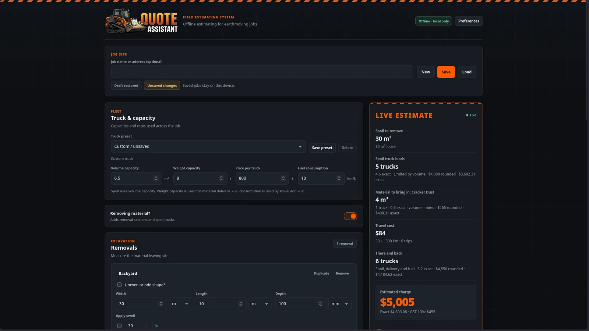
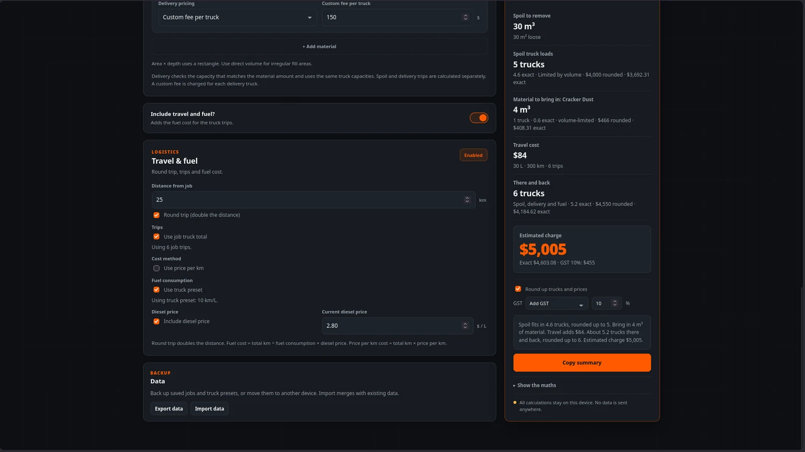

<p align="center">
  
</p>

<p align="center">
  <strong>Offline estimating for earthmoving jobs.</strong><br>
 Truck loads, material and a rough price, worked out on site.
</p>

<p align="center">
  <a href="https://github.com/DeSynkro/quote-assistant/blob/main/LICENSE"></a>
  <a href="https://github.com/DeSynkro/quote-assistant/blob/main/VERSION"></a>
  <a href="https://ko-fi.com/desynkro"></a>
</p>

<p align="center">
  Built by <a href="https://desynkro.com">DeSynkro</a> with assistance from <a href="https://opencode.ai">Opencode</a>.
</p>

<p align="center">
  Made with ♥️ Thank you to everyone who was welcoming and kind.
</p>

Quote Assistant is a small offline tool for estimating earthmoving jobs. Enter the truck size, the areas being removed and any material being brought to site, and it works out truck loads and a rough price.

It runs fully offline in a browser, can be self-hosted on a local network with Docker, and is packaged for Linux, Windows and Android.

## Why this exists

My father runs a small earthmoving and excavation business. I'm his apprentice and he's teaching me everything he knows. Dad is starting to feel his age, so I made him a little app to help with his quotes.

The goal was simple. While you're quoting a job and taking measurements for what needs to be removed or brought back to site, you can enter the details and measurements and the app calculates truck loads and a rough price based on your truck size.

At its heart, it's a preset calculator. You set up the size of your equipment and the measurements of what you need taken or brought and it calculates it for you. Simple as it gets.

## Status

Quote Assistant is a personal project and still improving.

## Requirements

- **Browser:** a modern browser. No installation or account is needed.
- **Docker:** Docker with the Compose plugin.
- **Linux:** the AppImage is self-contained and bundles the WebKitGTK and GTK libraries.
- **Windows:** Windows 10 or 11 with the WebView2 runtime, which is normally already installed.
- **Android:** Android 8 or later. The APK is installed manually.

## Quick Start

### Browser

Open `app/index.html` in your browser. The app works fully offline and stores data in the browser.

### Docker Compose

Run these commands from the project root. Prefix them with `sudo` if your Docker setup requires it.

```sh
cp docker/.env.example docker/.env
# Set PUID and PGID in docker/.env to match id -u and id -g.
docker compose -f docker/docker-compose.yml up -d --build
```

Open `http://<this-computer-ip>:8080` from another device on the same network.

The shared data lives in `docker/data/`. Stop the stack and copy that folder to back it up.

### Linux AppImage

Download the latest `.AppImage` from [Releases](https://github.com/DeSynkro/quote-assistant/releases). Then make it executable and run it:

```sh
chmod +x Quote-Assistant-1.0.0.AppImage
./Quote-Assistant-1.0.0.AppImage
```

### Windows portable .exe

Download the latest `.exe` from [Releases](https://github.com/DeSynkro/quote-assistant/releases) and run it. No installer is needed.

The `.exe` is much smaller than the AppImage because it uses the WebView2 runtime already installed on Windows. The Linux AppImage has to include its own WebKitGTK and GTK libraries.

### Android APK

Download the latest `.apk` from [Releases](https://github.com/DeSynkro/quote-assistant/releases), allow installation from your browser or file manager, and install it.

The current APK is about 463 MB because it is a universal debug build. It contains native libraries for four Android CPU architectures: `x86_64`, `arm64-v8a`, `x86` and `armeabi-v7a`. Those four libraries make up around 455 MB of the download, and the debug build keeps its debug symbols. A release build for `arm64-v8a` only would be much smaller. The current APK is debug-signed and intended for sideloading and testing.

## Screenshots

<p align="center">
  <a href="https://raw.githubusercontent.com/DeSynkro/quote-assistant/refs/heads/main/assets/screenshots/overview.webp"></a>
  <a href="https://raw.githubusercontent.com/DeSynkro/quote-assistant/refs/heads/main/assets/screenshots/estimate.webp"></a>
</p>

## Features

- **Truck setup:** volume capacity, weight capacity, price per truck and optional fuel consumption.
- **Truck presets:** save, load and delete reusable truck configurations.
- **Removals:** rectangle, uneven ends, manual area and manual volume sections, with per-section swell.
- **Materials in:** multiple material entries by volume, weight or area × depth, with delivery pricing.
- **Travel and fuel:** round trips, calculated or manual trips, fuel consumption, diesel price or price per km.
- **Quote readout:** exact and rounded totals, GST options and a plain-language summary.
- **Jobs:** save, load, search, duplicate and delete jobs.
- **Autosave and undo:** draft restore, unsaved changes indicator and a 10 second undo window.
- **Backups:** export and import jobs and truck presets as JSON.
- **Docker LAN sharing:** shared jobs and truck presets for everyone on the local network.
- **Preferences:** dark, light and system themes, measurement decimals, reduced motion and autosave.
- **Mobile:** responsive layout with a sticky estimate bar.
- **Private by default:** no accounts, telemetry, analytics or cloud storage.

## What data is stored

| Where | What |
| --- | --- |
| Browser | Jobs, truck presets and preferences in local browser storage |
| Docker | Jobs and presets in `docker/data/` |
| Native apps | Planned: JSON files in the OS app data folder |

No data is sent to an external service. Docker is intended for a trusted local network.

## Tech Stack

| Part | Technology |
| --- | --- |
| Frontend | Plain HTML, CSS and JavaScript |
| Docker server | Node built-in modules, no npm |
| Docker orchestration | Docker Compose |
| Docker storage | JSON files in `docker/data/` |
| Native shell | Tauri 2 and Rust |
| Native storage | Pretty-printed JSON in the OS app data folder |
| Testing | `node tests/run-tests.js` and `node --test tests/server.test.js` |

## Troubleshooting

### Port 8080 is in use

Change the host port in `docker/docker-compose.yml` or stop the other service using port 8080.

### Docker cannot write to the data folder

Set `PUID` and `PGID` in `docker/.env` to match your user and group IDs:

```sh
id -u
id -g
```

### Backups

Stop the Docker stack, copy `docker/data/` somewhere safe, then start it again. The JSON files are the full shared job and preset data.

## Development

The browser app has no build step. Open `app/index.html` directly.

Run the tests with:

```sh
node tests/run-tests.js
node --test tests/server.test.js
```

The browser test sandbox is available at `tests/tests.html`.

### Building the Linux AppImage

The AppImage builder runs in Docker and does not install Rust, Tauri or WebKit development packages on your host.

```sh
cd build/appimage
sudo docker compose up --build
```

The finished AppImage is copied to `dist/`.

If your user ID is not 1000, copy `.env.example` to `.env` in `build/appimage/` and set `PUID` and `PGID` to match `id -u` and `id -g`.

The builder image and Cargo caches stay in Docker storage and `build/appimage/cache/`. They can be removed safely.

The AppImage is much larger than the Windows `.exe` because it bundles WebKitGTK, GTK and the other Linux libraries needed to run independently of the host distribution. The Windows build uses the WebView2 runtime already provided by Windows.

### Building the Windows portable exe

This uses an experimental Linux cross-build with `cargo-xwin`. The result should be tested on Windows.

```sh
cd build/exe
sudo docker compose up --build
```

The finished executable is copied to `dist/Quote-Assistant.exe`. It is portable and uses the Windows WebView2 runtime.

If the cross-build fails or the executable does not run correctly on Windows, a native Windows build remains the fallback.

### Building the Android APK

The Android builder runs in Docker with the Android SDK, NDK, Java and Rust Android targets.

```sh
cd build/apk
sudo docker compose up --build
```

The finished APK is copied to `dist/Quote-Assistant.apk`. This is a debug-signed APK for sideloading and testing.

The first build downloads the Android SDK, NDK and Gradle dependencies, so it takes longer than later builds.

## Support

If you find this useful, you can support me on [Ko-fi](https://ko-fi.com/desynkro). You can find more of my work at [desynkro.com](https://desynkro.com).

## License

MIT. See [LICENSE](LICENSE).

## Credits

- Built by [DeSynkro](https://desynkro.com)
- Assisted by [Opencode](https://opencode.ai)
- Made for my dad's earthmoving business and shared for anyone who finds it useful
- Thank you to everyone who supported me, it means a lot 😄️

<p align="center">
  <a href="https://desynkro.com" target="_blank">
    
  </a>
</p>
